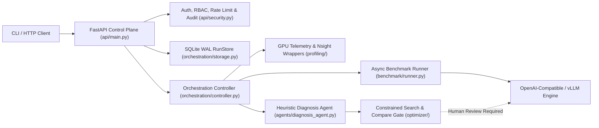

# Safe, Reproducible, and Agent-Assisted Optimization of Large Language Model Inference Serving

**Author:** Pramod M.  
**Repository:** [Inference-optimization](https://github.com/pramodm27/Inference-optimization)  
**Date:** November 2026  

---

## Abstract

Serving Large Language Models (LLMs) in production requires balancing strict interactivity Service Level Objectives (SLOs)—specifically Time to First Token (TTFT), Time Per Output Token (TPOT), and tail request latency—against aggregate GPU throughput. In practice, inference tuning is frequently performed through ad-hoc scripts that conflate Server-Sent Events (SSE) chunks with tokens, omit warmup or repeated trials, lack hardware telemetry correlation, and risk mutating live serving processes without regression guards.

This paper presents **Agentic Inference Optimizer**, a production-oriented control plane and experimental framework for benchmarking, profiling, diagnosing, and safely tuning OpenAI-compatible LLM inference engines (targeted at vLLM on NVIDIA GPU hosts). The system unifies: (1) an asynchronous streaming benchmark runner supporting both closed-loop concurrency and open-loop Poisson arrival-rate traffic with optional tokenizer-matched prompt corpora; (2) exact, server-usage-backed latency and throughput accounting; (3) isolated `nvidia-smi` telemetry and NVIDIA Nsight Systems/Compute capture wrappers; (4) an evidence-labelled heuristic diagnosis engine; (5) a schema-constrained candidate search and no-regression comparison gate requiring human review before promotion; and (6) a hardened FastAPI control plane backed by SQLite Write-Ahead Logging (WAL), role-based API key authentication, sliding-window rate limiting, and structured audit logging. We validate the control plane and measurement invariants across a 10-test unit and integration suite and analyze two recorded benchmark runs, demonstrating sub-150 ms p99 end-to-end latency and 247.54 output tokens/sec at concurrency 2 while documenting the remaining gaps for multi-engine, disaggregated, and hardware-saturated Pareto evaluation.

---

## 1. Introduction

Large Language Model inference has transitioned from batch offline generation to latency-critical, interactive serving across chat, coding assistants, and autonomous agentic workflows. Because modern LLM serving relies on high-bandwidth memory (HBM) and compute-dense accelerators such as NVIDIA H100-class GPUs, suboptimal serving configurations—such as poorly tuned batching limits, KV-cache allocation, or concurrency ceilings—directly translate into degraded user interactivity or wasted GPU capacity.

Despite the maturity of serving engines such as vLLM, TensorRT-LLM, and SGLang, operational performance engineering suffers from four recurring methodological failures:

1. **Measurement Distortion:** Streaming clients frequently count SSE frames as tokens, which breaks TPOT and throughput calculations whenever engines batch multiple tokens per SSE event or emit empty role/usage frames.
2. **Uncontrolled Experimentation:** Single-shot benchmarks without warmup phases, repeated trials, or fixed prompt corpora conflate JIT/cache warmup effects with steady-state performance.
3. **Closed-Loop Blindness:** Closed-loop concurrency runners bound in-flight requests artificially, masking queueing delays and coordinated-omission effects that appear under open-loop production arrival rates.
4. **Unsafe Autonomous Tuning:** Allowing automated optimization scripts or AI agents to mutate live serving flags without parameter allow-lists or multi-metric regression checks risks out-of-memory (OOM) crashes, silent quality degradation, or latency regressions hidden behind throughput gains.

**Contributions.** To address these challenges, this work designs, implements, and verifies **Agentic Inference Optimizer**, contributing:
- A **strict streaming measurement engine** (`benchmark/`) that separates TTFT from TPOT using server-reported token usage and supports both closed-loop concurrency and open-loop Poisson arrival-rate workloads.
- A **safe agentic optimization loop** (`agents/`, `optimizer/`) that encodes performance heuristics as explicitly labelled hypotheses (`heuristic_hypotheses_not_ground_truth`), restricts candidate configurations via a Pydantic allow-list, and enforces a no-regression gate (`accepted_for_human_review`) prior to deployment.
- A **durable, multi-tenant control plane** (`api/`, `orchestration/`) featuring SQLite WAL state persistence, crash recovery for interrupted jobs, constant-time HMAC-SHA256 API key authentication with RBAC, per-actor rate limiting, concurrent-job quotas, and JSONL audit trails.

---

## 2. Background and Metric Definitions

Rigorous LLM serving evaluation requires unambiguous definitions for interactivity, decode efficiency, and system capacity. Following the implementation in `benchmark/metrics.py` and `benchmark/engine_adapter.py`, we define the core metrics as follows.

### 2.1 Latency and Throughput Formulations

Let $L_i$ denote the end-to-end request latency (in seconds) for request $i$ from HTTP request initiation to stream completion, and let $\text{TTFT}_i$ denote the elapsed time from request initiation to the arrival of the first non-empty generated text delta. Let $C_i$ denote the server-reported `completion_tokens` count.

1. **Time to First Token ($\text{TTFT}_i$):** Captures network overhead, scheduler queueing, and prompt prefill computation.
2. **Time Per Output Token ($\text{TPOT}_i$):** Defined only when server-provided token usage is available and $C_i > 1$:
   $$\text{TPOT}_i = \frac{L_i - \text{TTFT}_i}{C_i - 1}$$
   When server usage metadata is omitted (`token_usage_available = False`), `completion_tokens` and `output_tokens_per_second` are explicitly recorded as `None` rather than estimated from SSE chunk counts.
3. **Aggregate Output Throughput ($T_{\text{out}}$):** Across $N$ completed requests spanning total trial wall-clock duration $W$ seconds:
   $$T_{\text{out}} = \frac{\sum_{i=1}^{N} C_i}{W}$$
4. **Tail Percentiles and Error Rate:** We compute $p50$, $p95$, and $p99$ across successful requests for $L$, $\text{TTFT}$, and $\text{TPOT}$, alongside $\text{error\_rate} = N_{\text{failed}} / N_{\text{total}}$.

### 2.2 Closed-Loop vs. Open-Loop Load Generation

In **closed-loop** mode, a fixed semaphore of size $c$ (`concurrency`) issues the next request only after an active request completes. While useful for measuring steady-state engine throughput at a fixed batch size, closed-loop testing cannot model bursty queueing. In **open-loop** mode (`mode="open_loop"`), requests are scheduled according to a Poisson arrival process with inter-arrival times $\Delta t \sim \text{Exp}(\lambda)$ where $\lambda = \text{arrival\_rate\_rps}$, subject to a safety semaphore cap (`concurrency`).

---

## 3. System Architecture

The framework is organized into six decoupled Python packages, separating workload generation, hardware profiling, heuristic diagnosis, constrained optimization, durable orchestration, and the HTTP control plane.

### 3.1 Benchmarking and Workload Control (`benchmark/`)
- **`VLLMOpenAIAdapter` (`benchmark/engine_adapter.py`):** Streams completions asynchronously via `httpx.AsyncClient` with bounded connection pools and `stream_options={"include_usage": True}`.
- **`run_benchmark` (`benchmark/runner.py`):** Executes an optional warmup batch (excluded from aggregate statistics) followed by $k$ repeated trials (`trials`). Prompts are either drawn round-robin from a tokenizer-matched `.jsonl` or plain-text corpus (`prompt_corpus_path`) or synthesized at an approximate target token length.
- **`BenchmarkRequest` (`benchmark/schemas.py`):** Enforces bounds on requests ($1\text{–}10{,}000$), concurrency ($1\text{–}512$), token lengths, trials, and mode-specific invariants (requiring `arrival_rate_rps` for open-loop mode and `requests >= concurrency` for closed-loop mode).

### 3.2 Hardware Telemetry and Profiling (`profiling/`)
To correlate request-level metrics with hardware behavior without destabilizing production traffic:
- `profiling/gpu_telemetry.py` executes `nvidia-smi` snapshots (offloaded to a worker thread via `asyncio.to_thread` so the FastAPI event loop is never blocked).
- `profiling/nsys_capture.py` and `profiling/ncu_capture.py` provide subprocess wrappers for NVIDIA Nsight Systems and Nsight Compute, explicitly documented for use only on isolated staging deployments due to profiling overhead.

### 3.3 Evidence-Labelled Diagnosis (`agents/diagnosis_agent.py`)
Rather than treating rule-based heuristics as ground truth, `diagnose(result, telemetry)` emits structured hypotheses tagged `type: "heuristic_hypotheses_not_ground_truth"` with `category`, `confidence`, `reason`, `next_step`, and explicit `limitations`. For example, an error rate exceeding 1% triggers a `reliability_or_overload` hypothesis, while high TTFT paired with low TPOT ($\le 0.08\text{ s}$) points toward prefill/queueing bottlenecks rather than decode bandwidth.

### 3.4 Safe Optimization Loop (`optimizer/`)
- **Parameter Allow-List (`optimizer/constraints.py`):** Candidate vLLM configurations are validated against a strict Pydantic schema (`extra="forbid"`), preventing arbitrary CLI flag injection or out-of-range memory/batch settings.
- **No-Regression Gate (`optimizer/compare.py`):** `compare_runs(baseline, candidate, max_error_rate=0.01)` requires that error rates remain within budget, latency and throughput metadata are present, **neither p95 latency nor output throughput regresses** ($L_{p95}^{\text{cand}} \le L_{p95}^{\text{base}}$ and $T_{\text{out}}^{\text{cand}} \ge T_{\text{out}}^{\text{base}}$), and at least one metric strictly improves before setting `accepted_for_human_review = True`.

---

## 4. Production Hardening and Governance

To transition the framework from a single-operator prototype to a multi-user control plane (`api/main.py`, `api/security.py`, `orchestration/storage.py`), five operational safeguards were implemented:

1. **Durable State & Crash Recovery:** Replaced ephemeral in-memory dictionaries with `RunStore` backed by SQLite in WAL mode (`results/runs.db`). On startup via FastAPI `lifespan`, `recover_stale_runs()` transitions any leftover `queued` or `running` records from an abrupt process termination to `failed` (`"Interrupted by server restart"`). Completed runs are written atomically via temporary files (`os.replace`) to `results/<run_id>.json` and appended to `results/runs.jsonl`.
2. **Authentication & RBAC:** Requests to `/v1/*` require `X-API-Key` or `Authorization: Bearer <token>` verified via constant-time `hmac.compare_digest` against configured `key:role` pairs (`viewer`, `operator`, `admin`). `viewer` roles may inspect GPU status and benchmark results; `operator`+ roles may launch benchmarks.
3. **Rate Limiting & Concurrency Quotas:** A per-actor sliding-window rate limiter (`RATE_LIMIT_RPM`) and active-job quota (`MAX_CONCURRENT_RUNS`) return HTTP `429` under excess load.
4. **Path Traversal Protection:** `GET /v1/benchmarks/{run_id}` validates `run_id` as a canonical `uuid.UUID` before any filesystem lookup.
5. **Audit Logging & Health Probes:** Every authenticated action logs a structured JSON event (timestamp, SHA-256-derived actor ID, role, HTTP status, `run_id`, client IP) to `results/audit.jsonl`. Public `/health` (liveness) and `/ready` (SQLite readiness) endpoints support container orchestration.

---

## 5. Empirical Evaluation and Verification

### 5.1 Automated Verification Suite
All components were verified under Python 3.13.2 using `pytest` (`10 passed in 1.10s`):
- **`tests/test_api_production.py`:** Verifies `/health`, `/ready`, `401` on missing/invalid keys, `403` RBAC enforcement for `viewer` on `POST /v1/benchmarks`, `202` execution for `operator`, `429` rate-limit enforcement, SQLite startup crash recovery, and audit log generation.
- **`tests/test_runner_modes.py`:** Verifies closed-loop/open-loop schema validation, `.jsonl` prompt corpus loading, and deterministic open-loop execution with `run_id` preservation.
- **`tests/test_compare.py`:** Verifies that `compare_runs` rejects candidates that improve throughput while regressing p95 latency.
- **`tests/test_constraints.py`, `tests/test_diagnosis.py`, `tests/test_metrics.py`:** Verify strict Pydantic allow-list bounds, heuristic diagnosis labelling, percentile interpolation, and failure accounting.

### 5.2 Recorded Benchmark Runs
Two benchmark runs were persisted in `results/` during local evaluation:

| Run ID | Outcome | Requests (Trials × Concurrency) | TTFT p50 / p99 | TPOT p50 / p99 | Latency p50 / p99 | Throughput (tok/s) |
| :--- | :--- | :---: | :---: | :---: | :---: | :---: |
| `f1c8d135-00d2-4472-9d82-423188777390` | Failed (`ConnectError`, 100% error) | 20 (2 × 10 @ c=2) | `null` | `null` | `null` | `null` |
| `c846bfa4-09c6-4dca-a5b0-a2f4e84c5c95` | Succeeded (0% error, 320 tok) | 20 (2 × 10 @ c=2) | 40.2 ms / 42.1 ms | 5.83 ms / 6.80 ms | 128.4 ms / 141.3 ms | 247.54 |

In run `c846bfa4-09c6-4dca-a5b0-a2f4e84c5c95` (80 prompt tokens, 16 output tokens, 2 warmup requests), warmup TTFT was 62.4 ms (p50) before stabilizing tightly around 40.2 ms (p50) and 42.1 ms (p99). Decode speed averaged ~171 tokens/sec per stream (5.83 ms/tok p50 TPOT), yielding sub-150 ms p99 total latency. Because the test host lacked an NVIDIA GPU (`nvidia-smi` returned `No such file or directory`), `diagnosis` conservatively reported `insufficient_evidence` rather than fabricating a hardware bottleneck.

---

## 6. Threats to Validity and Future Work

1. **Hardware Saturation Sweeps:** The recorded successful run reflects a light closed-loop workload (`concurrency=2`). Establishing credible Pareto frontiers (throughput-per-GPU vs. TTFT/TPOT) requires multi-concurrency open-loop sweeps on H100/B200-class hosts.
2. **Multi-Engine and Disaggregated Support:** Extending `benchmark/engine_adapter.py` to support TensorRT-LLM, SGLang, and disaggregated prefill/decode topologies (e.g., NVIDIA Dynamo) will enable cross-engine comparisons under identical workloads.
3. **Automated Trace-to-Hypothesis Parsing:** Integrating automated parsers for `.nsys-rep` and `ncu` CSV outputs into `agents/diagnosis_agent.py` will allow quantitative roofline and speed-of-light (SM compute vs. HBM bandwidth) attribution.
4. **Distributed Worker Queue:** For multi-node control planes, replacing the single-process `asyncio` task runner with a distributed worker queue (e.g., Redis/Temporal) and PostgreSQL would allow horizontal API scaling.

---

## 7. Conclusion

**Agentic Inference Optimizer** demonstrates how LLM inference performance engineering can be structured as a reproducible, safety-first control plane. By combining strict server-usage-backed streaming metrics, open-loop arrival-rate simulation, schema-constrained candidate generation, no-regression comparison gates, and durable API governance, the framework bridges the gap between ad-hoc benchmarking scripts and trustworthy, agent-assisted inference optimization.

---

## References
1. Kwon, W., et al. (2023). *Efficient Memory Management for Large Language Model Serving with PagedAttention (vLLM)*. SOSP.
2. Agrawal, A., et al. (2024). *Taming Throughput-Latency Tradeoffs in LLM Inference with Sarathi-Serve*. OSDI.
3. NVIDIA Corporation. *Nsight Systems & Nsight Compute Documentation*.
4. Repository Artifacts: `benchmark/runner.py`, `benchmark/metrics.py`, `agents/diagnosis_agent.py`, `optimizer/constraints.py`, `optimizer/compare.py`, `orchestration/storage.py`, `api/security.py`, `api/main.py`.
